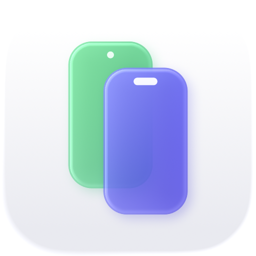
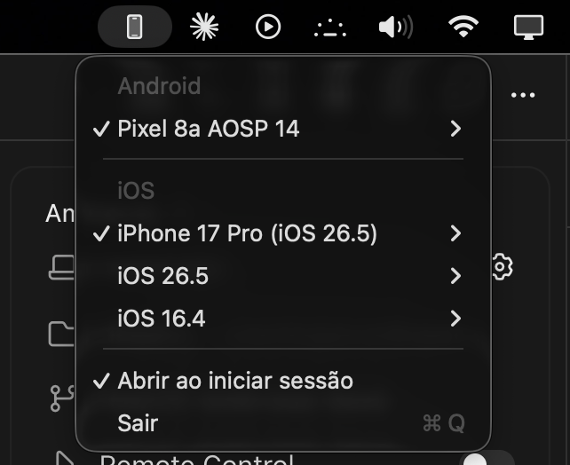

<div align="center">

<picture>
  <source media="(prefers-color-scheme: dark)" srcset="docs/icon-dark.png">
  
</picture>

# DeviceBar

**Emuladores Android e simuladores iOS a um clique, direto da barra de menus do Mac.**




</div>

Ligar um emulador não deveria exigir abrir o Android Studio ou o Xcode inteiros. O DeviceBar mostra todos os seus aparelhos virtuais num só menu: um clique liga, outro desliga.

- **Android**: liga suas AVDs. Segure **⌥** para fazer *cold boot*.
- **iOS**: simuladores de iPhone e iPad, agrupados por versão do iOS.
- **✓ no que está rodando**, com opções para mostrar ou parar.
- **Leve**: um único arquivo Swift, sem dependências e com 0% de CPU enquanto o menu está fechado.

## Download

Baixe o `DeviceBar-x.y.z.dmg` da [última release](https://github.com/andersonmendess/DeviceBar/releases/latest), abra e arraste o `DeviceBar.app` para a pasta Aplicativos. Também há um `.zip` com o mesmo app.

O app não é notarizado pela Apple, então na primeira vez o macOS vai bloquear a abertura. Para liberar, vá em **Ajustes do Sistema → Privacidade e Segurança** e clique em **Abrir Mesmo Assim**. Outra opção é rodar:

```sh
xattr -dr com.apple.quarantine /Applications/DeviceBar.app
```

Requer macOS 13 ou superior (Apple Silicon ou Intel). Para os simuladores iOS é preciso ter o Xcode instalado; para os emuladores Android, o Android SDK.

## Compilando

Requer o Xcode 26 ou superior.

```sh
git clone https://github.com/andersonmendess/DeviceBar.git
cd DeviceBar
./build.sh install
open ~/Applications/DeviceBar.app
```

Se o SDK não estiver em `~/Library/Android/sdk`, defina `ANDROID_HOME`.

## Licença

[MIT](LICENSE)
